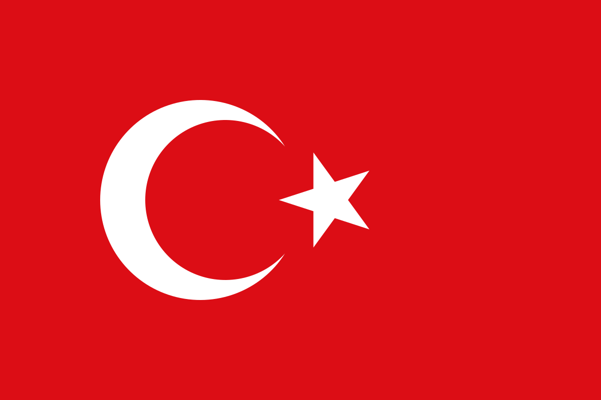

  

<h1 align="center">ay-yildiz-skill</h1>

Yapay zeka ajanları Türk Bayrağı'nı çizerken hep bir yerini kaçırıyor: ay biraz kaymış, yıldız ya büyük ya yamuk, kırmızı başka bir ton. Bu skill, bayrağı ve ay yıldızı ezberden değil, 2893 sayılı Türk Bayrağı Kanunu'na ekli cetveldeki ölçülerden hesaplanmış bir vektörden çizdiriyor. Kırmızı ise yasal renk değil, ekranda yaygın kullanılan bir devlet rengi. Bütün dayanaklar devlet kaynakları.

## Neler var

- `skills/ay-yildiz/SKILL.md`: kurallar, ay yıldızı kalkan, rozet ya da ikon gibi başka bir tasarıma yerleştirme, animasyon ipuçları ve iş bitmeden önce bakılacak kontrol listesi.
- `skills/ay-yildiz/assets/`: bayrağın tamamı ve sadece ay yıldız, SVG olarak.
- `skills/ay-yildiz/references/construction.md`: Kanun'a ekli ölçü cetveli, vektördeki her sayının nereden geldiği, renk ve Tüzük'teki küçük bir çelişki.
- `skills/ay-yildiz/references/official-table.png`: Kanun'daki çizim ve cetvel.
- `skills/ay-yildiz/references/construction-sheet.svg`: aynı cetvelin Türkçe ve İngilizce, ölçekli çizimi.
- `skills/ay-yildiz/references/construction.json`: bütün ölçüler, araçlar için.

## Kurulum

`skills/ay-yildiz` klasörünü kullandığın ajanın skills klasörüne kopyalaman yeterli.

## Lisans

MIT
