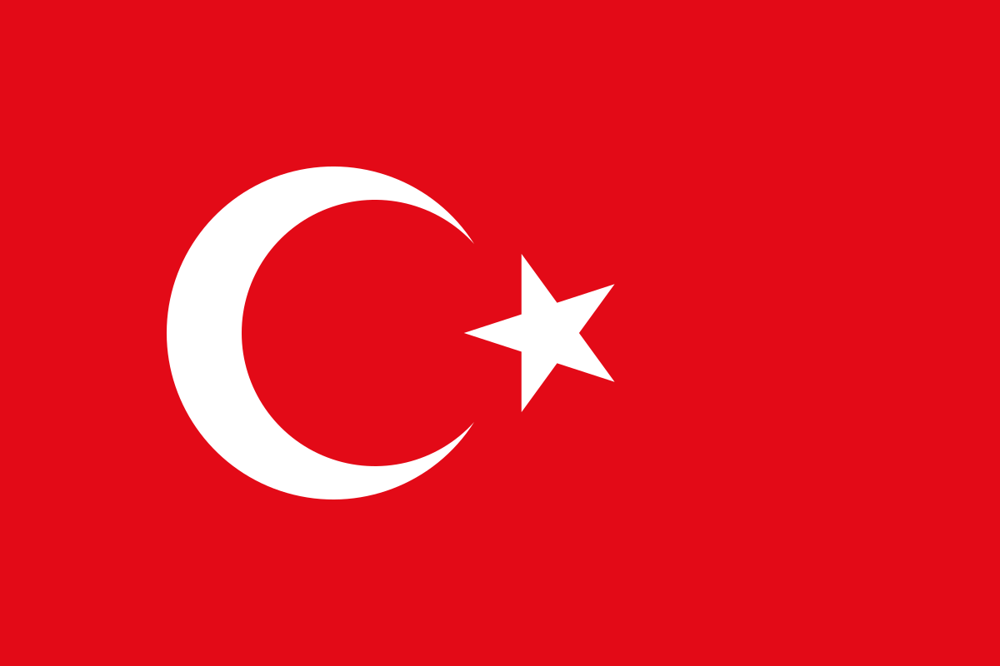

  

<h1 align="center">turkish-flag</h1>

<a href="#english">English</a> · <a href="#türkçe">Türkçe</a>

## English

An agent skill that draws the Turkish flag and its crescent and star exactly as the Turkish Flag Law (No. 2893) defines them, from a verified vector instead of from memory.

AI models drawing the crescent and star from memory get it almost right: the inner circle is shifted, the star is too big or turned, the red is off. This skill gives them the exact shapes and the rules for using them.

### What's inside

- `skills/turkish-flag/SKILL.md`: the rules, how to place and animate the crescent and star, where the law says the flag can't be used, and a checklist.
- `skills/turkish-flag/assets/`: the full flag and the crescent and star as SVG.
- `skills/turkish-flag/references/construction.md`: the official construction table from Law No. 2893 and how the vector follows from it.
- `skills/turkish-flag/references/official-table.png`: the official drawing and table from the law.

### Install

Copy `skills/turkish-flag` into your agent's skills folder.

### License

MIT

## Türkçe

Türk Bayrağını ve ay yıldızını, Türk Bayrağı Kanunu'nun (2893 sayılı) tanımladığı ölçülerle, ezberden değil doğrulanmış bir vektörden çizen bir ajan becerisi (skill).

Yapay zekâ modelleri ay yıldızı ezberden çizince neredeyse doğru çiziyor: iç çember kaymış, yıldız fazla büyük ya da dönmüş, kırmızı tonu farklı. Bu beceri onlara birebir şekilleri ve kullanım kurallarını veriyor.

### İçindekiler

- `skills/turkish-flag/SKILL.md`: kurallar, ay yıldızın yerleştirilmesi ve canlandırılması, kanunun bayrağın kullanılamayacağını söylediği yerler ve bir kontrol listesi.
- `skills/turkish-flag/assets/`: bayrağın tamamı ve yalnızca ay yıldız, SVG olarak.
- `skills/turkish-flag/references/construction.md`: 2893 sayılı Kanun'a ekli resmî cetvel ve vektörün bu cetvelden nasıl çıktığı.
- `skills/turkish-flag/references/official-table.png`: Kanun'daki resmî çizim ve cetvel.

### Kurulum

`skills/turkish-flag` klasörünü kullandığınız ajanın skills klasörüne kopyalayın.

### Lisans

MIT
